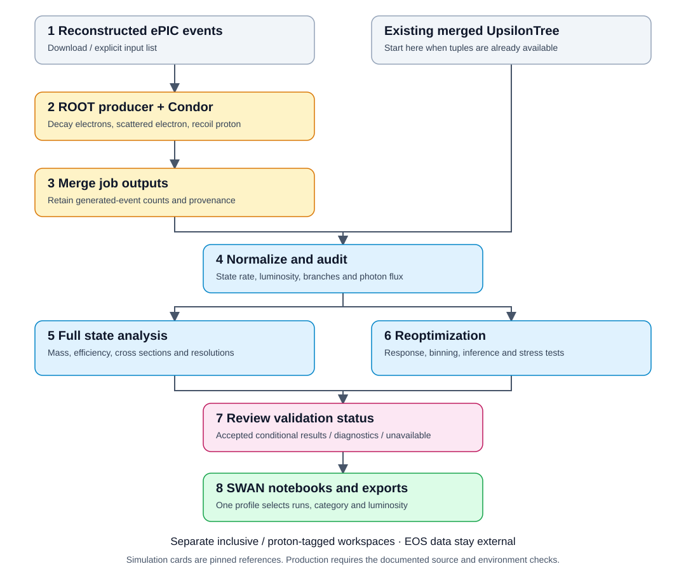

# ePIC Υ analysis

Use this repository to reproduce the Υ(1S), Υ(2S) and Υ(3S) figures in the ePIC early-science paper or to run the projections used in the analysis note. Both workflows start from merged ROOT files.

[Follow the analysis note in the Wiki](https://github.com/gkrintir/ePIC-Upsilon/wiki) to find the code and checks for each section and figure group.

## Clone and install

Python 3.11 or newer is recommended. Run the examples from the repository root.

```bash
git clone https://github.com/gkrintir/ePIC-Upsilon.git
cd ePIC-Upsilon
python3 -m venv .venv
source .venv/bin/activate
python3 -m pip install -r requirements.txt
```

## Reproduce the early-science paper

The paper projects proton-tagged events at 9×275 GeV and 2.5 fb⁻¹ for all three Υ states. The download includes those three merged files and the three 9×130 GeV files for the note’s beam-energy comparison. It preserves the directory structure and verifies each checksum. [CERNBox inputs](https://cernbox.cern.ch/s/UHPvC04xj29cxrp)

```bash
python3 inputs/fetch_paper_inputs.py work/paper-inputs
python3 paper/replay_paper.py --inputs work/paper-inputs --output work/paper-replay
```

If you already have the files, skip the download and point `--inputs` to the directory containing `Upsilon1S`, `Upsilon2S` and `Upsilon3S`. Choose a new `--output` directory for each replay.

The replay makes all three paper figures and checks the fitted yields, mass resolutions, efficiency maps, spectra and 1S slope against the saved paper results. Open `work/paper-replay/paper_replay.json` for the results of those checks. [Figure paths and expected values](paper/README.md)

## Analysis quick start

To run your own analysis, first copy the configuration file.

```bash
cp configs/local.example.json configs/local.json
```

In `configs/local.json`, set `input_base` to the absolute path of the directory containing the three state folders. For the download above, use the path printed by `realpath work/paper-inputs`.

```bash
python3 upsilon.py init --name tagged-v1 --selection proton-tagged
python3 upsilon.py doctor --workspace tagged-v1
python3 upsilon.py analysis run --workspace tagged-v1 --energy 9x275 \
  --states 1S 2S 3S --lumi 2.5 --batch-id tagged-275-L2p5 --hash-inputs
```

Use the same batch ID to optimize the bins and fit the spectra. The `status` command shows which observables passed validation.

```bash
python3 upsilon.py reopt run --workspace tagged-v1 --energy 9x275 \
  --states 1S 2S 3S --observables pt2 abs_t_via_pt2 w y --lumi 2.5 \
  --source-batch tagged-275-L2p5 --run-id reopt-275-L2p5 --hash-inputs
python3 upsilon.py status --workspace tagged-v1 --run-id reopt-275-L2p5
```

For the tagged 9×130 GeV projection, use `--energy 9x130 --lumi 1` and new batch and run IDs. In the tagged 1S study at this setting, every binning tested had at least one bin with fewer than five expected signal events, so the analysis could not fit a slope.

For the note’s equal-luminosity comparison, create a separate workspace with `--selection inclusive` (no recoil-proton tag requirement) and use `--lumi 10` for the analysis at each energy. [Analysis commands and output paths](docs/analysis.md)

## Plot saved results

The plotting notebooks use all three states at 9×275 GeV. To redraw a paper figure, copy the paper profile and set its paths and run IDs to your saved results.

```bash
cp configs/plots_9x275.paper.json configs/plots.local.json
```

- **W and rapidity spectra.** The optimizer selects the fit bins. For 1S, the paper profile keeps the first and last bins and combines the three middle bins for display. To draw the W and rapidity spectra, set `allow_diagnostic_results` to `true` in the profile. These spectra failed the coverage checks. [Validation results](docs/validation.md)
- **Mass and efficiency (notebook 07).** The notebook uses saved mass templates and efficiency counts. It reads the original 9×275 GeV 1S ROOT file to build the $W$–$x_V$ efficiency map. If you moved the ROOT file, set `root_input_override` to its new path. [Open notebook 07](plotting/07_mass_and_efficiency_w_xv.ipynb)

Open the notebook in JupyterLab or on CERN SWAN. Use the Python environment from the installation step and run all cells. [Notebook list and command-line options](docs/plotting.md)

## Workflow and reference



- **Tuple production.** If you start from reconstructed events, follow the [production guide](docs/production.md). The recovered macro fixes the proton beam at 275 GeV. New 9×130 production requires the corresponding producer and CERN job configuration. [Missing production sources](docs/missing-production-sources.md)
- **Electron identification and normalization.** All six inputs use reconstructed track–cluster matching (`ele_id_mode=1`). The event selection and photon flux use Q² upper limits of 1 GeV² for 1S and 0.01 GeV² for 2S and 3S. [Selections and normalization](docs/selections-and-normalization.md)
- **Efficiency maps.** To regenerate the two-dimensional maps from the merged files, follow the [efficiency guide](docs/efficiency.md).
- **Run records.** To resume a run or find its settings and outputs, see [bookkeeping](docs/bookkeeping.md).
